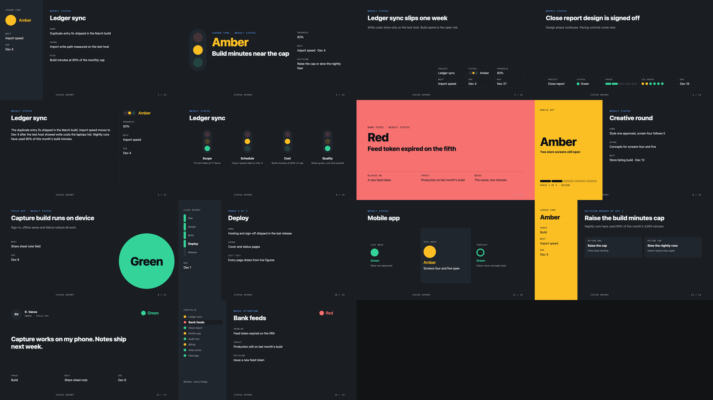

# Status templates

Fourteen templates report where one thing stands. Their source is `lib/templates/cat-status.mjs`, and `node bin/validate.mjs --templates` prints every key with its sample under the Status heading.

| Template | Shows |
|---|---|
| `status-rail` | One lamp and the status word in a left rail, three labelled facts beside it |
| `status-hero` | A three-lamp stoplight, the status word at display size and the one reason |
| `status-title-block` | A statement and a six-cell title block with a stoplight in the Status cell |
| `status-title-strip` | A statement over a full-width strip: name, lamp, a segment bar, a run of lamps, one closing fact |
| `status-margin-notes` | The week in a paragraph, a stoplight and three facts in the margin |
| `status-columns` | Four upright stoplights, one a dimension |
| `status-filled` | The whole ground in the status colour |
| `status-split` | A colour field with the status and a phase bar, three facts on the other half |
| `status-corner-lamp` | One oversized lamp with the status word inside it |
| `status-stage-rail` | A rail of phases, tranches or layers, each with its own state |
| `status-trajectory` | Last period, this period and a hollow forecast lamp |
| `status-decision` | A decision, its reason and two options beside a filled rail |
| `status-owner-note` | The owner's one-line statement with a lamp beside their name |
| `status-roster-rail` | A rail that lists every unit with its lamp, and a body that opens one |

## Lamp states and words

A lamp state is a value key: `0` not started (a hollow lamp), `1` green, `2` amber, `3` red. The status word beside a lamp is a text key. Write Green, Amber and Red for delivery, or Up, Degraded and Down for a live system.

## Colours

The lamps read four optional tokens, each with a default: `ok` #34D399, `warn` #FBBF24, `stop` #F87171 and `idle` #4B5563. A fifth, `on-status` (#0B0F17), is the ink on a status-coloured ground. A row reads them as `var(--ok,#34D399)`, so a deck that sets none gets the defaults. Add any of the five to `tokens` in `style.json` to re-theme every lamp.

## Lists that shrink

`status-roster-rail` takes `s1` to `s8` and `status-stage-rail` takes `s1` to `s5`. Fill the states you have, with their names, and the rows of the rest drop. `focus` and `at` name one of the rows you filled. `status-title-strip` takes up to six lamps, `l1` to `l6`, the same way. A stage rail of four stands taller than one of five.

## One bar, three readings

`status-title-strip` draws `segs` segments and lights `lit` of them in `barState`. Five segments read as phases and four as tranches. Thirty read as days, and `mark` names the day of an incident, drawn in `markState`.

## Filled grounds

`status-rail` fills its rail with the status colour when `fill` is 1 and sets the rail in dark ink. `status-decision`, `status-split` and `status-filled` always paint theirs.

## The footer

A rail or a colour field covers the left of the foot band, so move the deck's footer clear with a partial override on those slides:

- `status-rail`, `status-stage-rail`, `status-decision`: `{override: '<footer id>', x: 269}`
- `status-roster-rail`: `{override: '<footer id>', x: 298}`
- `status-split`: `{override: '<footer id>', x: 403, w: 150}`. A footer whose middle passes the canvas centre is seated on the right, so the width stays narrow.
- `status-filled`: `{override: '<footer id>', color: 'var(--on-status,#0B0F17)'}`

## Project, program, system

The same keys serve three subjects. The words and the unit change, the layout holds.

| | Project | Program | System |
|---|---|---|---|
| Unit in a roster or strip | projects | workstreams under one outcome | components and layers |
| What status means | delivery against plan, by week | a roll-up: the critical path and the outcome date | health now: up, degraded, down |
| What the cells carry | phase, weekly history, due date | tranche, dependencies, a not-started lamp, outcome date | a 30-day strip, last incident, version |
